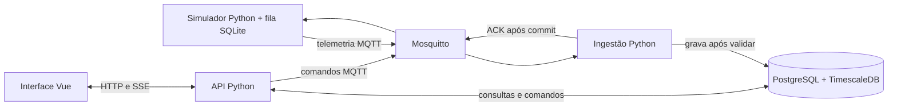

# eVOLVER CNPEM

Agentes de IA devem ler [AGENTS.md](AGENTS.md) antes de alterar o repositório.

## O que é o projeto

Este repositório reúne o software externo do piloto eVOLVER no CNPEM. Ele prepara o
recebimento, armazenamento e visualização de medições de cultura e o envio de comandos.
Nesta fase, tudo roda localmente com dados simulados: não há conexão com hardware real nem
efeito físico de comandos.

## Propósito

O piloto serve à equipe do laboratório para acompanhar e rastrear experimentos simulados
antes de uma possível integração física. Ele deve registrar densidade óptica (OD), pH e
temperatura medida, mantendo o setpoint de temperatura e os comandos das bombas separados.

## Como funciona



MQTT é o protocolo de mensagens; Mosquitto é o servidor que as encaminha. SSE
(*Server-Sent Events*) é a atualização da API para o navegador. O desenho acima é o
alvo do piloto; hoje a infraestrutura, os contratos e o banco estão implementados,
mas os processos de aplicação ainda não.

## Componentes

- Contratos MQTT: modelos Pydantic, JSON Schema e exemplos versionados para telemetria, confirmações e comandos (`packages/contracts/`).
- Mosquitto: serviço independente em `mqtt/`, autenticado e com permissões por tópico; sem mensagens retidas.
- PostgreSQL + TimescaleDB: banco persistente de metadados, comandos, auditoria e séries temporais (`compose.yaml`, `backend/migrations/`).
- Banco do backend: modelos SQLAlchemy, migration Alembic e consultas de medições atuais e históricas (Python).
- Simulador: publicador Python inicial de uma temperatura de teste; geração contínua e comandos ainda não foram implementados.
- Fila local: fila SQLite prevista no simulador para reenviar telemetria confirmada apenas após gravação central; ainda não implementada.
- Ingestão: processo Python previsto para validar MQTT, deduplicar e persistir; ainda não implementado.
- API: aplicação FastAPI prevista para consultas, autorização de comandos e SSE; ainda não implementada.
- Interface: aplicação Vue 3 + Vite prevista para painéis e gráficos; ainda não implementada.

## Decisões importantes

- MQTT 5 com QoS 1 para transportar telemetria e comandos; o ACK da aplicação só ocorre após o *commit* no banco, pois a confirmação do MQTT cobre apenas o transporte.
- Contrato `1.0` centralizado em modelos Pydantic; schemas JSON são gerados deles para não haver regras divergentes.
- PostgreSQL + TimescaleDB para combinar metadados relacionais e histórico temporal; Alembic versiona o schema.
- `event_id` único e horários de geração e recebimento separados, para reenviar eventos sem duplicá-los e preservar dados atrasados.
- Comandos MQTT não são retidos e têm prazo; comandos antigos de bomba não devem ser repetidos após reconexão.
- Navegador acessa apenas a API por HTTP/SSE, nunca o banco ou o broker diretamente.
- Piloto em uma única máquina, com serviços de infraestrutura em Docker Compose e código de aplicação previsto para rodar localmente durante o desenvolvimento.

## Estrutura de pastas

```text
docs/                 planejamento, arquitetura, stack e critérios de aceite
packages/contracts/   contrato MQTT compartilhado, schemas e testes
backend/              banco, migrations e futuro código de API e ingestão
simulator/            futuro processo externo de dados simulados
frontend/             futura interface Vue
infra/                inicialização local da extensão TimescaleDB
mqtt/                 serviço Mosquitto independente e suas verificações
operations/           operação, diagnóstico, backup e restauração
compose.yaml          serviço local de banco
```

## Como rodar e desenvolver

Pré-requisitos atuais: Docker Desktop com Compose v2, `uv` e Python 3.12. A interface,
quando criada, exigirá Node.js 22.12 ou superior.

1. Para testar somente MQTT e o simulador, siga [plano-mqtt-independente.md](docs/plano-mqtt-independente.md); backend e banco não são necessários.
2. Para preparar o banco separadamente, copie `.env.example` para `.env` e use o `compose.yaml` da raiz.
3. Crie o schema da aplicação: em `backend/`, execute `uv sync --group dev --frozen` e `uv run alembic upgrade head`.
4. Na raiz, valide o que já existe: `uv sync --all-packages --group dev --frozen`, `uv run --all-packages ruff check backend/src simulator/src packages/contracts/src packages/contracts/tests` e `uv run --all-packages pytest packages/contracts/tests backend/tests/db/test_models.py simulator/tests`.

O teste de integração do banco exige um banco descartável; siga
[backend/migrations/README.md](backend/migrations/README.md#teste-de-integração).
API, ingestão e frontend ainda não têm pontos de entrada funcionais. O simulador possui
somente a publicação inicial documentada. Para contribuir, mantenha os contratos como fonte de verdade,
não coloque credenciais reais no repositório e siga [AGENTS.md](AGENTS.md) e o
[guia de commits](docs/guia_commit.md).

## Onde aprofundar

- [arquitetura-e-fluxos.md](docs/arquitetura-e-fluxos.md): responsabilidades, fluxo de telemetria/ACK, comandos, falhas e recuperação; consulte ao implementar serviços.
- [escopo-e-aceite.md](docs/escopo-e-aceite.md): limites do piloto e cenários A1–A8 para demonstrá-lo; consulte ao definir ou validar entregas.
- [stack-e-desenvolvimento.md](docs/stack-e-desenvolvimento.md): tecnologias, versões, modos de execução e convenções previstas; consulte antes de adicionar dependências ou serviços.
- [guia_commit.md](docs/guia_commit.md): branches, commits e Pull Requests; consulte antes de trabalhar com Git.
- [VISAO_GERAL.md](docs/VISAO_GERAL.md): contexto do domínio eVOLVER, escopo ampliado e questões de integração futura; consulte para decisões de produto.

Documentação complementar: [contratos MQTT](packages/contracts/src/evolver_contracts/README.md),
[banco](backend/src/evolver/db/README.md), [migrações](backend/migrations/README.md),
[infraestrutura](infra/README.md) e [operações](operations/README.md).

## Estado atual e próximos passos

Já existem Compose independentes para Mosquitto e TimescaleDB, ACL/autenticação do broker, contrato
MQTT `1.0` com schemas e testes, e schema do banco com migration, modelos e consultas.
O simulador publica uma temperatura de teste; ainda faltam sua execução contínua, a ingestão e a API, a fila SQLite,
a interface e os testes de ponta a ponta dos cenários A1–A8. O procedimento de backup e
restauração está documentado, mas a demonstração completa do piloto ainda não foi comprovada.

### Dúvidas em aberto

- Definir limite e comportamento da fila SQLite, intervalo de reenvio e tratamento de disco cheio.
- Definir tempo para marcar leitura como antiga, parâmetros da demonstração e responsáveis pelo aceite.
- Definir local e evidência da restauração de backup e, no futuro, a interface segura com o equipamento físico.
