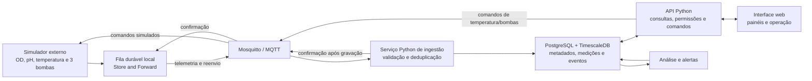

# eVOLVER CNPEM — visão geral do software externo

## Resumo do projeto

O eVOLVER é uma plataforma modular de cultivo microbiano contínuo que monitora e ajusta condições de culturas em frascos individuais. Sua finalidade científica é conduzir experimentos paralelos e reprodutíveis de crescimento, evolução e resposta a condições variáveis. Densidade óptica (OD), temperatura, agitação e eventos de fluidos/bombas são exemplos de dados e ações relevantes, conforme a configuração física disponível. A plataforma original combina *smart sleeves*, controle de fluidos e eletrônica modular; não se deve presumir que todos os módulos ou sensores estejam presentes no protótipo do CNPEM. [Artigo de apresentação da BU](https://www.bu.edu/articles/2018/evolver-growing-microbes/) · [Artigo científico](https://www.nature.com/articles/nbt.4151) · [Wiki oficial](https://khalil-lab.gitbook.io/evolver)

**Nosso projeto** é o software que roda em computador/servidor **fora do equipamento**: receber e conservar medições e eventos; organizar equipamentos, frascos, culturas e experimentos; permitir consulta histórica e acompanhamento em tempo real; oferecer painéis, alertas e exportação; e representar comandos de temperatura e bombas. **Nesta fase, os dados recebidos do eVOLVER serão simulados (*mockados*) e os comandos serão executados pelo simulador**, sem acionamento físico. O valor central é tornar os experimentos observáveis, rastreáveis e analisáveis durante e após a execução.

**Fronteira de escopo:** firmware, microcontroladores, eletrônica, bombas, controle térmico interno e qualquer agente que precise rodar dentro do equipamento ou em placa embarcada são sistemas externos a este trabalho. O simulador é um componente **externo** que produz telemetria e responde a comandos segundo o mesmo contrato previsto para uma integração futura.

### Variáveis e direção de comunicação definidas para o protótipo simulado

| Variável/atuador | Direção | Significado no sistema externo |
| --- | --- | --- |
| Densidade óptica (OD) | **Read** | Receber e registrar valores numéricos simulados, com horário e identificação da origem. |
| pH | **Read** | Receber e registrar valores numéricos simulados, com horário e identificação da origem. |
| Temperatura | **Read/Write** | Receber temperatura medida e enviar um valor desejado (*setpoint*) ao simulador. Manter os dois valores separados. |
| Bombas 1, 2 e 3 | **Write** | Enviar comandos independentes às três bombas simuladas. Tipo de ação e parâmetros (ligar/desligar, duração, vazão etc.) ainda precisam de definição; não presumir leitura de estado físico nem volume efetivo. |

## O que as pesquisas mostram

| Fonte | Contribuição para este projeto | Limite de interpretação |
| --- | --- | --- |
| [BU](https://www.bu.edu/articles/2018/evolver-growing-microbes/) e [Wong et al., 2018](https://www.nature.com/articles/nbt.4151) | Motivação: controle preciso e escalável de culturas, experimentos paralelos e manipulação de fluidos. | Descrevem a plataforma original, não as capacidades confirmadas do protótipo local. |
| [Wiki: arquitetura do software](https://khalil-lab.gitbook.io/evolver/software/overview-of-software-architecture) e [DPU](https://khalil-lab.gitbook.io/evolver/software/dpu) | No eVOLVER de referência, Raspberry Pi conversa com placas por RS-485; um computador de laboratório executa lógica experimental Python (DPU) e se comunica com o servidor da Raspberry por Socket.IO/WebSocket. A GUI Electron permite acompanhar dados, calibrar e enviar comandos. | Não há, nessas páginas, evidência de MQTT como interface nativa. MQTT está confirmado **para o nosso protótipo simulado**; conexão com equipamento físico exigiria verificar a interface ou criar uma ponte externa. |
| [Wiki: arquivos de dados](https://khalil-lab.gitbook.io/evolver/software/dpu/experiment-data-files), [calibração de temperatura](https://khalil-lab.gitbook.io/evolver/getting-started/calibrations/temperature-calibration) e [bombas](https://khalil-lab.gitbook.io/evolver/getting-started/calibrations/pump-calibration) | Distinguir leitura bruta de valor calibrado, meta de temperatura, limiar de OD e eventos de bomba; preservar a calibração usada. Temperatura afeta OD, e calibrações variam por frasco/componente. | Formatos e cadência documentados para versões do software original não constituem contrato para o CNPEM. |
| [Wiki: quimiostato](https://khalil-lab.gitbook.io/evolver/experiments/chemostat) e [início de experimento](https://khalil-lab.gitbook.io/evolver/experiments/starting-an-experiment) | Há modos experimentais com semânticas diferentes; intervenções de bomba e condições de partida importam para interpretar séries. | Não implementar turbidostato/quimiostato automaticamente sem confirmar quem executará a lógica de controle. |
| [Fórum eVOLVER](https://www.evolver.bio/), [post do CNPEM](https://www.evolver.bio/t/evolver-modifications-made-at-the-brazilian-center-for-research-in-energy-and-materials/436) e [discussão de comunicação](https://www.evolver.bio/t/websockets-dpu-evolver/48) | O post de 2023 relata montagem e mudanças físicas no CNPEM, com controle manual pela Raspberry Pi naquele momento. O fórum mostra a evolução de UDP para WebSockets na plataforma original. | O post não comprova o estado atual do hardware nem a disponibilidade de uma API de controle. |
| [Repositório da outra equipe](https://github.com/rafaelmnf/eVOLVER) | Pertence a **outro projeto, focado na parte física/hardware**. O repositório inclui software de apoio ao próprio protótipo: painel React/Vite, backend Express/TypeScript, MQTT, WebSocket, PostgreSQL e InfluxDB. Pode ajudar a entender como aquela equipe integrou seus componentes. | **Não é uma implementação mais avançada do nosso projeto de software externo nem um modelo arquitetural a seguir.** Sua topologia, modelos *master/slave*, payloads, retenção, linguagens e bancos não definem requisitos nossos. [README](https://github.com/rafaelmnf/eVOLVER/blob/main/README.md) · [ingestão MQTT](https://github.com/rafaelmnf/eVOLVER/blob/main/backend/src/services/mqtt.ts) · [esquema](https://github.com/rafaelmnf/eVOLVER/blob/main/backend/src/config/init.sql). |
| [FigJam da outra equipe](https://www.figma.com/board/e9ZoAOv3ZKa40s7hnpTEbT/eVOLVER?node-id=19-725) | Quadro público do **projeto de hardware dessa outra equipe**. A leitura visual mostra ideias de GUI, diagramas Python ↔ Raspberry Pi ↔ Arduino/16 *smart sleeves*, fluxo de sensores e notas de componentes físicos, inclusive Raspberry Pi Pico 2 W. | É contexto sobre o trabalho deles e sobre a plataforma eVOLVER; **não documenta decisões, escopo ou arquitetura do nosso software externo**. A visualização pública não exige permissão de edição. |
| [GitHub Project](https://github.com/users/KachanChK/projects/4/views/2) e [issues](https://github.com/KachanChK/eVOLVER-CNPEM/issues) | Planejamento das etapas: escopo e aceite, arquitetura, stack, contratos MQTT, simulador, ingestão, rastreabilidade, interface, segurança, resiliência e testes. | Replanejado para o simulador externo; a versão inicial, com agente Java **no equipamento** e lógica experimental local, foi descartada. Datas do quadro são metas e dependem da disponibilidade da equipe. |

O repositório e o FigJam acima **não são entregáveis, etapas anteriores ou extensões deste projeto**. A equipe deles trabalha principalmente no equipamento físico; esta equipe desenvolve a aplicação externa com dados simulados nesta fase. Referências entre os trabalhos servem apenas para compreender o domínio e possíveis interfaces futuras.

### Consequências para o nosso desenho

1. **Telemetria não é experimento.** Uma medida precisa ser associada ao equipamento, posição/frasco e execução experimental corretos, inclusive quando chega atrasada ou é reenviada. A identificação da cultura e das condições do ensaio vive em metadados versionados, não apenas no tópico MQTT.
2. **Observado, desejado e executado são estados distintos.** A temperatura medida não é o *setpoint*. Publicar um comando não prova que o atuador o recebeu ou que houve efeito físico. Eventos de bomba também não equivalem automaticamente a volume real dispensado.
3. **Calibração é contexto da plataforma original, não requisito do piloto mockado.** O software original transforma valores na DPU e mantém arquivos distintos para dados crus e calibrados. No nosso protótipo, valores simulados servem para testar aquisição, persistência, visualização e falhas; não precisam reproduzir uma escala científica. [DPU](https://khalil-lab.gitbook.io/evolver/software/dpu/evolver.py) · [arquivos](https://khalil-lab.gitbook.io/evolver/software/dpu/experiment-data-files).
4. **O simulador define o primeiro contrato testável.** A plataforma original usa Socket.IO na rede local; a outra equipe usa MQTT em seu próprio projeto de hardware. Nenhuma das duas implementações define o contrato do nosso sistema. Nesta fase, validaremos tipos de mensagem, identificação, horários, estados e respostas a comandos entre simulador e software externo. Capturar uma leitura real e identificar a interface física são atividades futuras, caso a integração com o equipamento entre no escopo.
5. **Segurança de comando vem antes de automação.** O controle remoto de bombas e parâmetros pode mudar um experimento ou causar transbordamento. Qualquer operação ativa precisa de limites, usuário autorizado, confirmação de resultado e procedimento de parada apropriado ao equipamento.

## Decisões confirmadas e detalhes em aberto

| Item | Situação | Papel no projeto |
| --- | --- | --- |
| **Mosquitto / MQTT** | **Confirmado** | Transporte de mensagens entre simulador externo e serviços centrais. Não implica suporte MQTT já existente no hardware real. |
| **PostgreSQL + TimescaleDB** | **Confirmado** | Persistência de metadados, eventos e séries temporais; consultas recentes e históricas. A interface recebe atualizações pelo backend, não diretamente do banco. |
| **Backend Python** | **Confirmado** | API, ingestão, validação, regras de acesso, consulta, alertas e entrega de atualizações ao navegador. FastAPI, definido no T03. |
| **Interface web** | **Confirmado** | Painel de dispositivos e culturas, experimentos, gráficos, estado de conexão, histórico e operações simuladas. Vue 3 + Vite e Chart.js, definidos no T03. |
| **Dados mockados / simulador externo** | **Confirmado nesta fase** | Gerar OD, pH e temperatura; aceitar comandos simulados de temperatura e das três bombas; reproduzir falhas e reconexão de maneira controlada. |
| **Store and Forward** | **Confirmado** | Persistir telemetria pendente no produtor externo, reenviar após reconexão e removê-la somente depois de confirmação de gravação central. Limite de armazenamento e tratamento de disco cheio são detalhes de implementação. |
| **Controle de temperatura e três bombas** | **Confirmado no protótipo simulado** | Expor operações Write no simulador e rastrear pedido, aceitação e resultado simulado. Controle físico futuro depende de validação separada. |

## Arquitetura conceitual para o software externo

Todos os blocos do desenho rodam fora do equipamento. O simulador substitui a fonte física nesta fase. Em integração futura, ele poderá ser substituído por uma interface real ou por um adaptador externo, mediante validação própria.

**Atualização em tempo real, na medida do possível:** o backend deve enviar ao navegador cada leitura nova e cada mudança relevante de estado assim que forem persistidas, via SSE (ver T03). A tela não deve depender de recarga manual. Após queda da conexão, o navegador recupera o estado atual pelo backend e volta a receber atualizações. Não se fixa agora uma taxa de amostragem nem um prazo numérico de latência; a interface deve indicar quando o dado foi produzido/recebido e se está desatualizado.

### Responsabilidades sugeridas

- **Simulador e fronteira de integração:** produzir medições mockadas de OD, pH e temperatura, receber comandos de setpoint e bombas e devolver resultados simulados. Usar mensagens versionadas. Futuramente, um adaptador externo pode traduzir o protocolo real; não duplicar nem disputar a autoridade de controle de um software experimental já em operação.
- **Broker:** transportar telemetria, estado e comandos; isolar tópicos por equipamento e tipo. QoS do MQTT melhora entrega ao assinante, mas **não comprova gravação no banco nem execução física**. Evitar comandos perigosos em mensagens retidas; definir expiração e identidade de destinatário.
- **Ingestão:** validar estrutura, tipo numérico, origem, identificadores e horários; rejeitar ou isolar mensagens malformadas; deduplicar por `event_id` ou chave equivalente; confirmar persistência somente após a transação no banco. Não exigir faixas ou unidades científicas para os valores mockados. Dados atrasados entram no histórico sem redefinir automaticamente o “valor atual”.
- **Banco:** usar tabelas relacionais para equipamentos, posições, culturas, experimentos, calibrações, usuários, configurações, comandos e auditoria; séries temporais para leituras e eventos com partição/índices adequados. Definir retenção, agregações, backup e restauração com o laboratório.
- **API:** oferecer leitura de estado e séries, gestão de metadados e operações autorizadas. Para painéis ao vivo, publicar atualizações quando houver novos dados ou eventos e sempre permitir recarregar um estado consistente do banco após reconexão.
- **Análise e alertas:** computar somente métricas cuja interpretação científica tenha sido aprovada; distinguir alerta de sensor inválido, dado antigo, equipamento desconectado e valor fora do limite. Registrar quando e por qual regra o alerta foi gerado.

### Store and Forward no software externo

O simulador/produtor grava cada medição em uma **fila durável local** antes de tentar publicar. Se perder a conexão com o broker ou o serviço central, continua acumulando eventos até o limite de capacidade definido para o piloto. Ao reconectar, reenvia pendências preservando `event_id`, horário original, sequência e vínculo com o experimento. A ingestão usa chave idempotente para que reenvios não dupliquem o histórico. O produtor só marca um evento como concluído após receber uma **confirmação da aplicação emitida depois do commit no PostgreSQL**; uma duplicata já gravada também pode ser confirmada. Mensagens inválidas precisam de rejeição explícita e área de quarentena para não travar a fila indefinidamente. Se uma confirmação se perder, o reenvio é seguro porque o mesmo `event_id` será reconhecido. O painel mostra atraso da fila e idade da última leitura, em vez de apresentar dados antigos como atuais.

Isso é diferente da persistência do broker: [QoS 1 do MQTT](https://docs.oasis-open.org/mqtt/mqtt/v5.0/os/mqtt-v5.0-os.html) admite entregas repetidas e confirma a etapa de transporte; a [persistência do Mosquitto](https://www.mosquitto.org/man/mosquitto-conf-5.html) conserva estado do broker quando habilitada. Nenhum dos dois, isoladamente, prova a gravação no banco. Definir limite da fila, política quando o disco encher, periodicidade de reenvio e teste de reinício. Esta garantia cobre o **produtor externo simulado**; não demonstra conservação de dados dentro do eVOLVER real.

Comandos Write exigem política diferente: não executar automaticamente comandos antigos de bomba ou temperatura após uma reconexão. Definir validade curta, identificação única, deduplicação e estado de resultado desconhecido. Testar o reenvio de um comando somente quando houver semântica segura e verificável no simulador; a política para equipamento físico será decidida à parte.

### Contrato mínimo do simulador e de uma integração futura

Uma mensagem de medição deveria identificar: `schema_version`, `event_id`, `equipment_id`, `vial_id`/posição, `experiment_run_id` (quando houver), tipo de medida (`od`, `ph` ou `temperature`), valor numérico, horário de geração e sequência/ordem da origem. A ingestão acrescenta o **horário de recebimento**. Faixas, unidades e calibrações científicas não são necessárias para testar o software com dados mockados; podem ser adicionadas se houver integração física futura. Os valores de exemplo podem ser arbitrários, desde que variem de modo previsível para testar gráficos e cenários de falha.

Para comandos de temperatura e das bombas `1`, `2` e `3`: `command_id`, alvo, ação, parâmetros, execução experimental, autor, instante de criação, prazo de validade e estados separados de **solicitado → aceito/rejeitado → enviado → recebido → executado/falhou/resultado desconhecido**. A operação simulada precisa devolver uma resposta correlacionada por `command_id`. Reenviar um comando de bomba sem saber o resultado anterior pode provocar duas ações em uma integração física; a política de repetição deve ser específica por comando. A associação entre usuário e comando deve ser auditável.

## Produto e escopo incremental propostos

**Primeiro piloto com dados simulados:** inventário de equipamentos/posições; cadastro de experimentos e culturas; simulador e contrato de mensagens; ingestão robusta de **OD, pH e temperatura**; Write de **setpoint de temperatura e três bombas simuladas**; Store and Forward; gráficos atuais e históricos; indicação de frescor e qualidade; eventos de conexão; exportação de dados; backup e restauração testados. Validar fluxos e consistência com cenários reproduzíveis do simulador. Dados mockados não validam precisão científica nem comportamento físico.

**Etapa seguinte, condicionada:** integração com equipamento real e eventual execução de rotinas experimentais, somente se a interface física suportar leitura/comandos com resposta verificável, houver responsável técnico para limites e houver uma única autoridade de controle. Gestão de calibrações e métricas derivadas pode ser desenhada com o simulador, mas só pode ser validada cientificamente com referências aprovadas. Turbidostato e quimiostato são modos documentados na plataforma original, mas sua implementação neste software não foi definida.

**Fora do escopo atual:** reescrever firmware ou o servidor embarcado, fabricar eletrônica, desenvolver agente Java na Raspberry/placa, prometer autonomia durante queda de rede sem mecanismo existente no equipamento, ou reproduzir integralmente a GUI/DPU original. O [planejamento](https://github.com/users/KachanChK/projects/4/views/2) já foi revisto para excluir esses itens.

## Questões a resolver antes de implementar

1. **Semântica dos comandos simulados:** definir se cada bomba receberá liga/desliga, duração ou outro comando simples e como o simulador responderá. Isso é necessário para implementar Write, mesmo que os números e unidades sejam arbitrários.
2. **Store and Forward:** escolher capacidade da fila local e comportamento ao atingir o limite; verificar reenvio após perda de conexão e reinício, sem duplicar leituras.
3. **Operação:** definir onde os serviços rodarão e como serão feitos backup, recuperação e acesso à interface. O painel deve atualizar a cada dado ou evento relevante, na medida do possível, e mostrar quando a informação estiver antiga.
4. **Aceite da fase atual:** verificar com cenários mockados ingestão, histórico, desconexão, reenvio sem duplicatas e rastreabilidade dos comandos simulados.
5. **Integração física futura:** capacidades e protocolo do equipamento real continuam como pesquisa posterior e não bloqueiam o desenvolvimento atual.

## Próximos passos recomendados

1. Fechar o contrato mockado: OD Read, pH Read, temperatura Read/Write e três bombas Write; definir tipos de mensagem e respostas dos comandos. Usar valores sintéticos simples, sem compromisso com escalas ou unidades científicas.
2. Manter o [quadro](https://github.com/users/KachanChK/projects/4/views/2) alinhado ao simulador externo, com datas ajustadas à disponibilidade real da equipe.
3. Construir simulador externo com fila durável, versionar mensagens e validar ingestão e confirmação após commit com Mosquitto, Python e PostgreSQL/TimescaleDB. Exercitar desconexão, reinício, duplicação e dados atrasados.
4. Mostrar ao laboratório um painel com séries mockadas, fila pendente e rastreabilidade dos comandos simulados; depois definir se haverá integração física.
