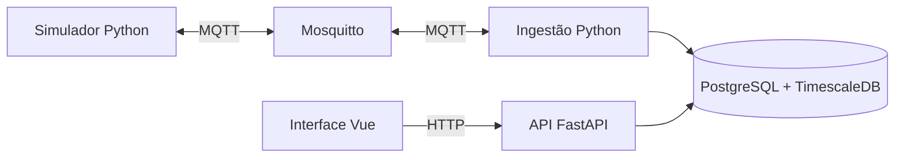

# Arquitetura atual do eVOLVER CNPEM

O sistema separa a geração de dados, a ingestão e a consulta. O simulador usa o contrato MQTT para se comunicar com o backend e roda como um processo independente. A interface usa HTTP e consulta o que já está no banco por meio da API. No ambiente local, somente o banco e o broker rodam em contêineres, com arquivos Compose separados. [Como executar](../README.md)

## Onde cada parte fica

| Caminho | Responsabilidade |
| --- | --- |
| `simulator/` | Consulta as alocações ativas, gera medições e responde a comandos do grupo de bombas. [Simulador](../simulator/README.md) |
| `mqtt/` | Executa o Mosquitto de forma independente, com credenciais e permissões de acesso por tópico. [Broker](../mqtt/README.md) |
| `backend/src/evolver/` | A ingestão valida e grava mensagens, toma decisões de controle e publica comandos. A API administra experimentos e expõe leituras e histórico. São processos Python separados. [Ingestão](../backend/src/evolver/ingestion/README.md) · [API](../backend/src/evolver/api/README.md) |
| `backend/migrations/` | O Alembic versiona as tabelas de cadastro, leituras e controle. [Migrações](../backend/migrations/README.md) |
| `packages/contracts/` | Modelos Pydantic e esquemas JSON compartilhados pelo backend e pelo simulador. [Contratos MQTT](../packages/contracts/src/evolver_contracts/README.md) |
| `frontend/` | Vue 3, Vite e Chart.js para cadastro, gráficos e supervisão do grupo. [Interface](../frontend/README.md) |

## Como uma leitura chega à tela

1. A cada rodada, o simulador pede à ingestão a lista de alocações ativas pelo MQTT. Para cada vial ativo, publica temperatura, pH e OD. A rodada tem intervalo de referência de 0,5 segundo.
2. A ingestão confere o equipamento, o vial e a alocação. A alocação tem um UUID próprio, que separa experimentos sucessivos no mesmo vial. A ingestão grava a leitura com os horários de geração e recebimento. O histórico usa o horário de geração, inclusive quando a leitura chega depois de outras mais recentes.
3. A interface consulta a API por HTTP a cada cinco segundos. O painel de OD e de bombas lê, na mesma consulta, as medições de OD, o estado do grupo, os comandos, as transições e a data de encerramento, quando houver.

### Decisões que importam

- **Mensagens versionadas.** O MQTT 5, com QoS 1, permite entregas repetidas. O `PUBACK` confirma a entrega ao broker. A gravação é observada no banco ou pela API. Mensagens inválidas são registradas no log da ingestão.
- **Um banco para cadastro e histórico.** O PostgreSQL mantém os vínculos entre vials, experimentos e comandos. O TimescaleDB organiza as três séries de leituras pelo horário de geração. Cada série usa a chave `(event_id, generated_at)` para ignorar a reentrega da mesma mensagem.
- **Consulta periódica.** A interface usa requisições HTTP para ler o estado persistido. SSE e `LISTEN/NOTIFY` ficaram nas propostas iniciais, assim como o Compose com todos os serviços. [Planejamento da stack](legacy/stack-e-desenvolvimento.md)

## Como o grupo de bombas é controlado

Cada alocação tem um grupo fixo de três bombas simuladas, com um estado e um comando por ação. O campo `pump_id: 1` representa o grupo no MQTT. A ingestão usa a OD mais recente, verificada para a alocação e gerada há no máximo dez segundos. Com o grupo desligado, atingir o limite superior solicita ligar. Com o grupo ligado, atingir o limite inferior solicita desligar. Entre os limites, o estado é mantido. Essa regra é a histerese.

1. A ingestão registra a intenção no PostgreSQL e publica um comando com validade e `command_id` próprio. Enquanto houver um comando pendente, o grupo aguarda seu desfecho.
2. O simulador verifica se a alocação está ativa e se o comando ainda vale. Ao aplicar a ação, grava o estado do grupo e o resultado no SQLite antes de responder com o mesmo `command_id`. Se o simulador receber novamente um comando já concluído para a mesma alocação ativa, devolve o resultado gravado.
3. `received` indica recebimento. `executed` confirma a execução simulada. Se a confirmação se perder, o estado pode ficar **Desconhecido**. Para voltar a decidir pela OD após uma reconexão da ingestão, o sistema primeiro confirma o desligamento do grupo.

Pausar impede novos comandos de ligar e solicita desligamento quando necessário. A retomada volta a avaliar a OD após confirmar que o grupo está desligado. Encerrar um experimento com o grupo ligado ou desconhecido também exige confirmar o desligamento antes de liberar o vial. No PostgreSQL ficam as solicitações, os resultados recebidos e as transições que aparecem no histórico da interface. [Implementação do controle de OD](../backend/src/evolver/ingestion/control.py)

## O que foi validado

O ensaio de integração registrou dois ciclos de ligar e desligar o grupo via MQTT, com persistência no banco e consulta pela API. Os testes cobriram pausa, retomada, encerramento, duplicatas e perda de confirmação. A interface foi verificada por testes automatizados e pelo build. [Registro da validação](legacy/evidencias-controle-bombas/README.md)

As pendências e os limites do piloto estão no [guia do projeto](projeto.md#o-que-falta).
