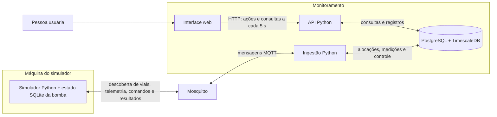
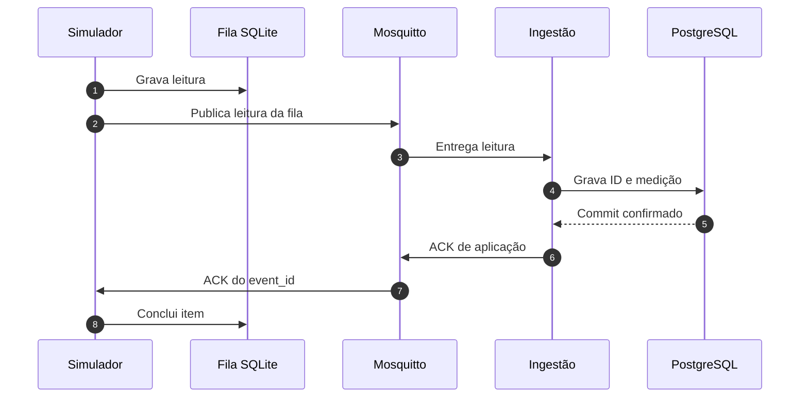
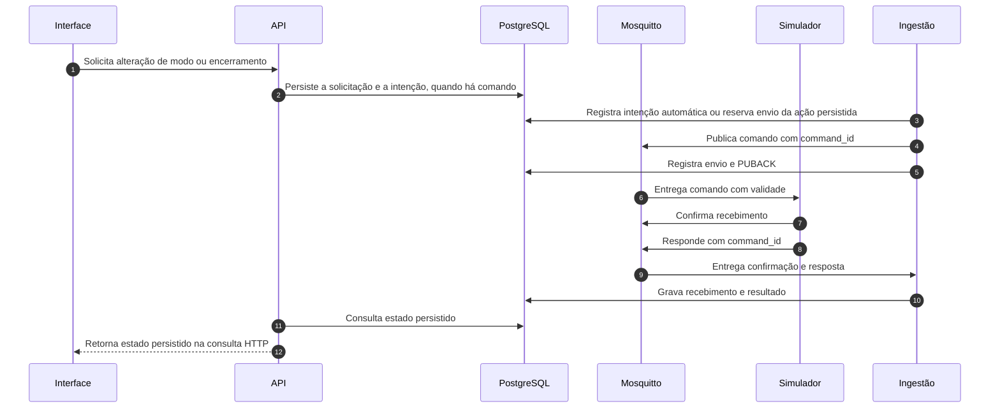

# E1 · T02 — Arquitetura externa e fluxos

**Etapa:** 1 — Planejamento  
**Prioridade:** P0  
**Período:** 27–29/10/2026  
**Dependências:** E1 · T01 (#1) e decisões técnicas  
**Status:** desenho documentado; decisões de implementação e testes do piloto pendentes

**Fronteira:** software e serviços executados fora do equipamento; piloto inteiramente local, com simulador e comandos sem efeito físico.

## Objetivo

Registrar o desenho exigido pela [issue #2](https://github.com/KachanChK/eVOLVER-CNPEM/issues/2): componentes em uma máquina, responsabilidades, fronteiras, falhas e recuperação. Separar telemetria simulada, confirmação após gravação, comandos e respostas. Este documento descreve o comportamento esperado; a implementação e os resultados dos testes serão comprovados pelo roteiro de [escopo e aceite](escopo-e-aceite.md).

## Diagrama de contexto

A topologia prevista para a Spec 6 usa máquinas separadas para o simulador e
a stack de monitoramento. O simulador Python consulta os vials ativos, publica telemetria, recebe
comandos e publica resultados pelo broker MQTT, único intermediário. A stack de
monitoramento contém ingestão, PostgreSQL/TimescaleDB, API e interface. A API,
o PostgreSQL e os arquivos do monitoramento ficam restritos ao lado do
monitoramento. O arquivo SQLite da bomba lógica pertence ao simulador.

Na máquina do simulador, configure `MQTT_HOST` com o nome DNS ou IP do broker
acessível na rede, `MQTT_PORT` com a porta publicada (por exemplo, 1883) e
`MQTT_SIMULATOR_PASSWORD` com a credencial do usuário `evolver-sim-01`.
Execute `python -m evolver_simulator --env-file <arquivo>`. No exemplo local,
o Compose publica o broker em `127.0.0.1`. Para acesso remoto, defina
`MQTT_BIND_HOST` no ambiente do Compose como o IP da interface privada da
máquina do broker. Permita a porta TCP do broker no firewall apenas a partir dos
clientes autorizados. O listener interno do contêiner já escuta em `0.0.0.0`.
Mantenha autenticação, ACLs e credenciais exclusivas para a rede de teste.
O exemplo de desenvolvimento usa MQTT sem TLS e pressupõe rede privada.
Se o broker também estiver fora do host do monitoramento, a ingestão aponta
`MQTT_HOST` e `MQTT_PORT` para esse endereço com as credenciais de ingestão.
O PostgreSQL e a API não precisam ser publicados para o simulador.
Sincronize os relógios das máquinas para que a idade da OD e a validade
dos comandos usem a mesma referência de tempo.

O exemplo local continua útil para desenvolvimento. O simulador representa o
produtor e o executor lógico de comandos nesta fase.

**Leitura do diagrama:** MQTT (*Message Queuing Telemetry Transport*) é o protocolo de mensagens; Mosquitto é o *broker* (servidor que as encaminha). SQLite guarda o estado simulado da bomba em arquivo local; TimescaleDB acrescenta suporte a séries temporais ao PostgreSQL. ACK é a confirmação da aplicação de uma leitura. O banco é a fonte do estado persistido. O navegador não acessa o banco nem o broker diretamente. As setas mostram o caminho previsto, não execução comprovada.

Na implementação da Spec 6, o navegador atualiza os dados persistidos por
consultas HTTP a cada 5 s. O [T03](stack-e-desenvolvimento.md) descreve a
proposta anterior de SSE.

## Diagrama de componentes e fronteiras

O fluxo de telemetria abaixo preserva o desenho original do piloto para
a fila durável de leituras. Na jornada da Spec 6, o SQLite guarda o estado da
bomba no simulador e a ingestão persiste a telemetria no TimescaleDB.
O diagrama de comandos já mostra o fluxo de controle de OD da Spec 6.

**Telemetria, gravação e confirmação**

**Comando e resposta simulada**

O PUBACK do broker comprova a entrega ao transporte. A ingestão confirma
a persistência da leitura após o commit. O banco guarda o histórico e a
auditoria e a API atende o navegador. O estado simulado da bomba sobrevive
ao reinício do produtor pelo SQLite. Backup e restauração continuam como
requisitos do desenho original do piloto.

## Responsabilidades previstas no desenho original

| Componente | Responsabilidade no piloto | Não significa |
| --- | --- | --- |
| Simulador Python | Gerar OD (densidade óptica), pH e temperatura medida com IDs, sequência e horário de geração; gravar leituras na fila antes de publicar; receber setpoint e comandos ligar/desligar das bombas 1, 2 e 3; responder com o mesmo `command_id` e resultado simulado. | Sensor calibrado, atuador real, vazão, volume bombeado ou execução física. |
| Fila local durável (SQLite) | Manter leituras até confirmação da aplicação; preservar `event_id`, sequência e horário original; recuperar pendências após reinício; expor quantidade, idade pendente e erro de publicação. | Substituto de backup ou garantia contra perda do disco/host. |
| Mosquitto / MQTT | Transportar mensagens entre produtores e consumidores locais, com tópicos separados para telemetria, ACK, comandos e respostas. | Banco de dados, confirmação de commit, execução de comando ou interface comprovada do hardware eVOLVER. |
| Ingestão Python | Validar esquema, origem, IDs e horários; registrar horário de recebimento; impedir duplicatas; gravar em transação; emitir ACK de aplicação somente após commit; receber resultados simulados e persistir eventos correlacionados. | Autoridade para inferir efeito científico ou físico. |
| PostgreSQL + TimescaleDB | Guardar metadados, medições, eventos de conexão, comandos e auditoria; garantir unicidade lógica por `event_id` na tabela de IDs processados, gravada na mesma transação da medição; servir como fonte do histórico persistido. | Prova de que um comando alterou equipamento físico. |
| API Python | Fornecer consultas e estado consistente, impor autorização para ações, validar prazo/alvo de comandos, registrar autor e publicar comandos; expor mudanças persistidas à interface. | Acesso direto do navegador ao MQTT ou ao banco. |
| Interface web | Mostrar estado recente e histórico, horários de geração/recebimento, frescor/conexão e fila pendente; permitir ações simuladas e apresentar os estados do comando sem confundi-los. | Fonte primária dos dados ou confirmação independente de execução física. |

## Contratos e distinções de estado

### Telemetria

Cada leitura inclui no mínimo: `schema_version` (versão do formato), `event_id` (identidade estável), `equipment_id` lógico do simulador, posição/frasco e, quando aplicável, `experiment_run_id`; tipo `od`, `ph` ou `temperature` e valor numérico; `generated_at` (horário de geração) e sequência do produtor. A ingestão acrescenta `received_at` (horário de recebimento). Reenvios preservam `event_id`, sequência e `generated_at`; o banco impede duas gravações lógicas para o mesmo ID.

Um horário antigo não torna o evento inválido: ele entra no histórico pelo horário de geração, mas não substitui automaticamente o valor mais recente já conhecido.

### Comandos

Todo comando contém `command_id` (identidade de correlação), tipo/alvo, ação/valor, instante de criação, prazo de validade, autor e vínculo com a execução experimental quando aplicável. No piloto, os alvos são setpoint de temperatura e bombas 1, 2 e 3 com ação ligar/desligar.

Apresentar estados separados e só avançar quando houver evidência correspondente:

1. **Solicitado:** a API registrou a intenção e seu autor.
2. **Aceito ou rejeitado:** a API validou autorização, alvo, ação e prazo; a rejeição tem motivo.
3. **Enviado:** publicação ao broker concluída; isto só comprova envio ao transporte.
4. **Recebido:** há confirmação correlacionada de que o simulador recebeu o comando.
5. **Executado no simulador ou falhou:** a resposta correlacionada foi gravada. **Resultado desconhecido** indica ausência de resposta conclusiva; não deve ser apresentado como execução.

Temperatura **medida** é telemetria; temperatura **desejada** é setpoint. Valores publicados, recebidos e executados são estados diferentes. Para bombas, não inferir estado físico, vazão nem volume real.

## Fluxos principais

Os itens 1 a 5 preservam a descrição histórica do planejamento do piloto.
O item 6 descreve o controle de OD implementado na Spec 6.

### 1. Telemetria normal e confirmação pós-commit

1. O simulador cria a leitura com `event_id`, sequência e `generated_at`.
2. Grava a leitura na fila SQLite antes de tentar publicar.
3. Publica telemetria no tópico MQTT correspondente.
4. A ingestão valida esquema e origem, abre transação e grava a medição e o ID processado, ou identifica uma duplicata já gravada.
5. Após commit bem-sucedido, a ingestão publica ACK de aplicação com `event_id` e resultado `persistido` ou `duplicado`. Falha de gravação não gera ACK de persistência.
6. O simulador recebe o ACK e marca o evento como concluído/removível da fila.
7. A API consulta o banco e atualiza a interface com valor, horário de geração, horário de recebimento e frescor.

ACK de QoS (nível de qualidade de serviço) do MQTT confirma uma etapa do transporte. Ele não substitui o ACK de aplicação emitido depois da persistência central. **Verificar e registrar na implementação:** para o mesmo `event_id`, guardar estado da fila antes/depois, log de commit e do ACK posterior, consulta ao banco e captura da interface. Espera-se um registro lógico e saída da fila somente após o ACK de aplicação. Corresponde a A1, A2 e A4 do T01; este documento não comprova o ensaio.

### 2. Desconexão, Store and Forward e reinício

1. Se broker/ingestão/banco estiver indisponível, a publicação falha ou não recebe ACK de aplicação. *Store and Forward* significa guardar localmente e reenviar depois.
2. O evento continua na fila local, sem trocar identidade ou horário.
3. A tela indica desconexão, idade da última leitura e/ou pendências; dados anteriores não são rotulados como atuais.
4. Após reconexão, o produtor reenvia eventos pendentes segundo a política configurada.
5. Se o evento já tiver sido persistido antes da perda do ACK, a ingestão o reconhece como duplicata, não cria novo registro e pode emitir novamente o ACK.
6. Depois do ACK pós-commit, o produtor conclui o item da fila.
7. Se a máquina reiniciar, o produtor recupera a fila durável; ingestão e API recuperam estado do banco.

**Verificar e registrar:** anotar os IDs e a contagem da fila antes da falha, durante a falha e após reconexão/reinício; guardar logs de reenvio e ACK, consulta de unicidade no banco e captura do aviso de dado antigo. Espera-se preservar todos os eventos válidos, sem duplicatas lógicas (A3–A5 do T01). Capacidade da fila, política quando cheia e intervalo de repetição ainda serão definidos. Se a fila atingir o limite, o sistema deve sinalizar o problema sem apagar eventos antigos silenciosamente. Na Spec 6, a atualização da interface ocorre por consultas HTTP periódicas.

### 3. Mensagens inválidas e quarentena

Evento malformado ou incompatível com `schema_version` recebe rejeição explícita e motivo registrado. Deve ser isolado em quarentena ou encaminhado para tratamento manual, para não bloquear indefinidamente os demais eventos. Evento inválido não recebe confirmação de persistência válida e não deve ser descartado silenciosamente. **Verificar e registrar:** enviar mensagem inválida identificável, guardar log de rejeição e motivo, registro de quarentena/tratamento e evidência de que a leitura válida seguinte foi processada. O mecanismo de quarentena ainda será definido.

### 4. Dados atrasados e fora de ordem

A ingestão conserva `generated_at`, `received_at`, sequência e identidade do produtor. Armazena eventos atrasados no histórico pelo horário de geração, sem regredir a última leitura da mesma fonte e tipo. Para investigar atraso, comparar também horário de recebimento e sequência. **Verificar e registrar:** enviar dois eventos da mesma fonte e tipo em ordem inversa de geração; guardar consultas do histórico e da última leitura. Espera-se que ambos apareçam uma vez e que o mais recente por geração continue como último (A6 do T01).

### 5. Comandos e respostas simuladas no desenho original

1. Usuário solicita ação pela interface.
2. API registra `command_id`, autor e estado **solicitado**; valida autorização, alvo/ação e prazo, e registra **aceito** ou **rejeitado**, com motivo.
3. API publica comando não retido, com validade limitada, para o simulador por MQTT.
4. O estado **enviado** é registrado separadamente do recebimento.
5. Simulador valida prazo e identidade, altera apenas seu estado simulado e devolve resposta com o mesmo `command_id`. A confirmação de recebimento e o resultado são eventos distintos.
6. Ingestão valida a correlação e grava a resposta/evento; a API mostra o resultado persistido como executado no simulador, falhou ou rejeitado, conforme a evidência.
7. Se a resposta não chegar, mostrar **resultado desconhecido**. Não repetir automaticamente comando antigo de bomba após reconexão. Uma nova tentativa exige política explícita e não deve esconder a incerteza do resultado anterior.

Comandos expirados durante desconexão são recusados pelo simulador e permanecem auditáveis como expirados/rejeitados. O piloto não usa comandos MQTT retidos para atuadores. **Verificar e registrar:** guardar pedido, `command_id`, autor disponível no piloto, validação, publicação, confirmação de recebimento, resposta, consulta de auditoria e captura dos estados. Testar setpoint e ligar/desligar de cada bomba separadamente, além de comando expirado durante desconexão. Espera-se correlação pelo mesmo ID e nenhuma execução do expirado (A7 do T01). Semântica de retentativa e timeouts continuam pendentes.

### 6. Controle de OD da Spec 6

A API registra limites e mudanças de modo no banco. A ingestão encontra as
alocações ativas em resposta a pedidos via MQTT e decide se deve solicitar
ligar ou desligar a bomba lógica. Na subida, OD no máximo ou acima dele
solicita ligar. Na descida, OD no mínimo ou abaixo dele solicita desligar.
Entre os limites, conserva o estado confirmado. A mesma ingestão publica o
comando persistido, com validade e identificador da alocação. O simulador
consulta a alocação via MQTT, executa a ação no seu estado local e publica o
resultado. A ingestão registra o resultado e o estado na mesma transação. A
interface consulta a API para mostrar a intenção, o resultado e as mudanças
observadas pelo banco. O fluxo de pausa, recuperação e encerramento está
descrito em [Controle de OD](controle-od.md).

## Decisões registradas e decisões pendentes

### Base adotada para o desenho

**Escopo incluído:**

- Uma máquina local, com os componentes externos do piloto.
- Simulador Python e valores mockados como origem/destino de telemetria e comandos; nenhuma ação tem efeito físico.
- Mosquitto/MQTT para transporte no protótipo simulado.
- Ingestão e API em Python; PostgreSQL + TimescaleDB como persistência central; interface web.
- Fila durável no produtor, ACK de aplicação após commit, deduplicação por identidade estável e histórico que aceita dados atrasados.
- Separação entre temperatura medida e setpoint; entre publicar, receber e executar comando simulado.

