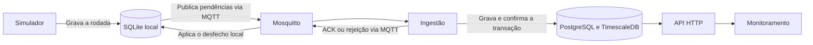

# Spec · Store and Forward de telemetria

**Escopo confirmado em 23/11/2026** · Piloto local com OD, pH e temperatura simulados. A implementação cobre coleta durante a indisponibilidade, confirmação da gravação central e atualização do histórico no monitoramento. [Tarefa de implementação #6](https://github.com/KachanChK/eVOLVER-CNPEM/issues/6) · [Validação de falhas #13](https://github.com/KachanChK/eVOLVER-CNPEM/issues/13)

## Resultado esperado

Depois de uma queda do MQTT, da ingestão ou do banco, cada leitura válida confirmada no SQLite local deve aparecer uma única vez no histórico do experimento original. O simulador mantém a leitura pendente até receber a confirmação de aplicação de que ela já está no PostgreSQL. A API e a tela ordenam o histórico pelo horário de geração. Uma leitura recuperada entra no histórico sem acionar o grupo de bombas.

O piloto cobre um simulador em execução para `evolver-sim-01`, até 12 vials, três medições por vial por rodada e rodada de 0,5 s. A garantia começa no commit local de cada rodada e requer o retorno dos serviços e a integridade dos arquivos da fila e do banco. Enquanto o processo estiver desligado, não há geração de amostras. Equipamento físico, firmware, comandos de setpoint, reenvio de comandos e recuperação de volumes apagados pertencem a outros escopos. [Guia do projeto](projeto.md) · [Arquitetura atual](arquitetura-atual.md)

## Base verificada no repositório

| Ponto | Código atual e efeito na spec |
| --- | --- |
| Coleta e publicação | O simulador consulta as alocações a cada rodada e publica cada evento esperando `PUBACK`. A falha da consulta ou da publicação pode encerrar a execução. Coleta, descoberta e envio precisam ter ciclos independentes. [Ciclo do simulador](../simulator/src/evolver_simulator/runner.py) · [Cliente MQTT](../simulator/src/evolver_simulator/mqtt.py) |
| Confirmações | Os modelos, exemplos e permissões dos tópicos `telemetry/ack` e `telemetry/rejection` existem. A ingestão hoje grava e registra o resultado no log. O simulador ainda precisa assinar e processar as duas respostas. A descrição dos vials ativos no contrato também precisa incluir `allocation_id`, que o código já retorna. [Contrato MQTT](../packages/contracts/src/evolver_contracts/README.md) · [Modelos das alocações](../packages/contracts/src/evolver_contracts/pilot.py) · [ACL](../mqtt/acl) · [Ingestão](../backend/src/evolver/ingestion/__main__.py) |
| Histórico e idempotência | As três hipertabelas deduplicam por `(event_id, generated_at)` dentro da própria série. O legado propõe uma tabela comum de IDs. Ela cobre também um UUID repetido com outro horário ou em outra série. [Modelos de banco](../backend/src/evolver/db/models.py) · [Planejamento da stack](legacy/stack-e-desenvolvimento.md) |
| Alocações e bombas | O vínculo moderno é o UUID da alocação em `experiment_run_id`. A ingestão já verifica o intervalo da alocação. A OD com alocação verificada alimenta o controle, com janela de 10 s. O filtro de idade sozinho permite que um reenvio de uma queda curta influencie a automação. [Ingestão](../backend/src/evolver/ingestion/__main__.py) · [Controle](../backend/src/evolver/ingestion/control.py) |
| Monitoramento | A interface consulta a API por HTTP a cada 5 s. O gráfico compartilhado calcula o aviso de frescor com `received_at`, e o resumo de OD já usa `generated_at`. O desenho legado de SSE e `LISTEN/NOTIFY` ficou no planejamento. [API](../backend/src/evolver/api/main.py) · [Gráfico das séries](../frontend/src/TemperatureHistory.vue) · [Arquitetura legada](legacy/arquitetura-e-fluxos.md) |

O fechamento da issue #7 registra a entrega anterior de ingestão. O ACK de aplicação e a rejeição correlacionada continuam pendentes no código verificado em `2f2dcea`. Os cenários A3–A6 do aceite legado servem de base para a validação desta entrega. [Issue #7](https://github.com/KachanChK/eVOLVER-CNPEM/issues/7) · [Critérios legados](legacy/escopo-e-aceite.md#critérios-e-roteiro-de-demonstração)

## Fluxo proposto

### 1. Coleta e fila local

- Usar `sqlite3` em arquivo local dedicado à telemetria, no mesmo diretório padrão do estado das bombas. Configurar o caminho com `SIMULATOR_TELEMETRY_QUEUE_PATH`. Usar transações por rodada e `WAL` com `synchronous=FULL` em disco local. Um único simulador é dono da fila. Vincular o arquivo à identidade do equipamento e do produtor e sinalizar configuração incompatível antes de publicar. [SQLite · Write-Ahead Logging](https://www.sqlite.org/wal.html)
- Guardar a última resposta válida e correlacionada de vials ativos, incluindo a lista vazia. Atualizar a lista em segundo plano. A coleta usa essa lista enquanto a ingestão estiver indisponível, inclusive após reinício. Na primeira execução sem lista confirmada, o simulador espera a descoberta. A recuperação da fila já existente pode seguir independentemente de uma resposta nova.
- Gravar a rodada em uma única transação com o JSON validado a ser publicado. Preservar `event_id`, `producer_id`, `equipment_id`, `vial_id`, UUID da alocação, tipo, valor, `sequence` e `generated_at` em todos os envios. Após o reinício, as pendências conservam sua sequência original. A sequência das novas leituras segue a semântica atual por execução do gerador.
- Dimensionar a fila para **259.200 eventos** por padrão, configurável por `SIMULATOR_TELEMETRY_QUEUE_MAX_EVENTS`. A conta é `12 × 3 × 2 × 3.600`. A partir de uma fila vazia, isso cobre uma hora no ritmo máximo do piloto. Pendências e itens em quarentena ocupam espaço da fila. Medir na homologação o espaço real do SQLite e dos arquivos auxiliares e registrar a reserva de disco exigida para esse cenário.
- Ao faltar espaço para a rodada, pausar novas coletas e registrar o motivo. Preservar as linhas existentes e continuar o envio e a aplicação de desfechos na medida em que o disco permitir. Retomar automaticamente quando houver espaço para uma rodada. Tratar `SQLITE_FULL` e falhas de escrita com rollback. Expor o estado degradado e manter a possibilidade de reenviar um item cujo ACK chegou, mas cuja remoção local falhou. [SQLite · Códigos de erro](https://www.sqlite.org/rescode.html)
- Manter os limites e as falhas simuladas da CLI vinculados a eventos novos. `--max-messages` limita a quantidade de leituras novas gravadas. Após atingir o limite, o processo tenta concluir os envios dentro do prazo de confirmação e registra as pendências duráveis ao sair. Em execução contínua, a fila fica disponível para reenvio automático.

### 2. Envio e confirmação

- Reusar MQTT 5 com QoS 1 e `retain=False`. Assinar `telemetry/ack`, `telemetry/rejection`, respostas de alocação e comandos no início de cada sessão. Aguardar o `SUBACK` dos tópicos exigidos antes de publicar telemetria. A indisponibilidade inicial do broker deve permitir a abertura do SQLite e a coleta com a lista salva. `PUBACK` indica o resultado da etapa MQTT. [OASIS MQTT 5.0, §4.3.2](https://docs.oasis-open.org/mqtt/mqtt/v5.0/os/mqtt-v5.0-os.html) · [Cliente Paho](https://eclipse.dev/paho/files/paho.mqtt.python/html/client.html)
- Usar uma janela limitada de publicações aguardando desfecho de aplicação, com valor inicial de 128. Enviar as pendências históricas elegíveis por ordem de entrada. Reservar até uma rodada de espaço na janela para os eventos ao vivo, mantendo o envio do histórico em paralelo na mesma conexão. Falha de transporte ou ausência de desfecho mantém o item na fila. Usar prazo inicial de 5 s para o ACK de aplicação e repetir com atraso progressivo de 1 s a 30 s, medidos por relógio monotônico. Um item aguardando nova tentativa deixa a janela livre para os demais. A mesma política limita tentativas quando a ingestão ou o banco estiverem fora, mesmo com o broker conectado.
- A fila SQLite é a fonte do reenvio. Usar sessões MQTT sem expiração persistente e iniciar um cliente Paho novo fora das callbacks após perder a sessão, para que o transporte não reapresente uma cópia marcada como ao vivo. O produtor retoma os envios históricos com os mesmos payloads após o novo `SUBACK`. A persistência já habilitada no Mosquitto continua servindo ao broker. [Paho 2.1.0 · Limitações conhecidas](https://github.com/eclipse-paho/paho.mqtt.python/tree/v2.1.0#known-limitations) · [Mosquitto · Persistência](https://mosquitto.org/man/mosquitto-conf-5.html)
- Validar o tópico, a identidade do equipamento, a versão, o payload e o `event_id` de toda resposta. Ignorar respostas retidas ou sem item pendente correspondente. `persisted` e `duplicate` autorizam a remoção em transação local. `quarantined` muda o estado do item em transação, preservando JSON, identidade, código, detalhe e horário da rejeição. A quarentena é consultável localmente e sai da cota somente após remoção explícita pelo operador, com procedimento documentado de exportação.

### 3. Ingestão e idempotência

- Em cada transação, reservar o `event_id` numa tabela PostgreSQL comum com chave primária. Guardar tipo, `generated_at` e um hash do payload validado com serialização determinística e horário normalizado em UTC. Propriedades MQTT e `received_at` ficam fora do hash. Para um ID novo, gravar seu registro, a leitura correspondente e a eventual decisão de OD na mesma transação. Usar as chaves compostas atuais nas hipertabelas. [TimescaleDB · Índices únicos em hipertabelas](https://www.tigerdata.com/docs/build/performance-optimization/hypertables-and-unique-indexes) · [PostgreSQL 17 · `INSERT`](https://www.postgresql.org/docs/17/sql-insert.html)
- Se o ID já estiver gravado, comparar a identidade e o conteúdo registrados. Conteúdo equivalente retorna `duplicate`, preserva o `received_at` original e dispensa nova avaliação de OD. Conteúdo divergente é conflito permanente. Preencher o registro de IDs preexistentes na migração Alembic a partir das três séries. Para registros anteriores à spec, comparar os campos já disponíveis na leitura original e seus vínculos. Alguns metadados, como sequência e produtor em séries antigas de pH e temperatura, nunca foram gravados. Se a migração encontrar o mesmo UUID em mais de uma linha, interromper e listar os conflitos para diagnóstico, preservando os dados.
- Publicar o ACK em `evolver/v1/{equipment_id}/telemetry/ack` somente depois do commit bem-sucedido, com `status` `persisted` ou `duplicate`. Manter commit síncrono no piloto. Erro de banco, timeout ou resultado incerto do commit mantém a tentativa sem desfecho. O reenvio resolve o caso em que o banco gravou a leitura e o ACK se perdeu. [Contrato MQTT](../packages/contracts/src/evolver_contracts/README.md#telemetria-ack-e-rejeição) · [PostgreSQL 17 · Configuração do WAL](https://www.postgresql.org/docs/17/runtime-config-wal.html)
- Preservar a validação histórica do vínculo com o intervalo `[started_at, ended_at)`. Para o produtor atualizado, `experiment_run_id` contém o UUID da lista confirmada. Quando o vial for reutilizado, uma leitura gerada dentro do intervalo original continua naquele experimento. Leituras geradas a partir do `ended_at` efetivo vão à quarentena. O horário da solicitação de encerramento pode preceder o `ended_at` quando a confirmação do desligamento estiver pendente. [Alocações e encerramento](arquitetura-atual.md#como-o-grupo-de-bombas-é-controlado)
- Distinguir falhas permanentes de transitórias. Publicar `telemetry/rejection` para falhas permanentes quando for possível correlacionar o UUID e a origem pelo tópico autorizado. Reusar `schema_invalid`, `unsupported_schema_version`, `unknown_equipment`, `unknown_vial` e `invalid_origin` do contrato. Usar `schema_invalid` para valores não finitos ou números sem representação na coluna de destino e `invalid_origin` com detalhe para alocação incompatível, horário fora do intervalo da alocação ou conflito de identidade. Uma leitura cujo horário ainda está no futuro fica pendente, com diagnóstico e reenvio. Para JSON sem correlação, registrar o erro na ingestão. Validar os itens locais antes do envio e isolar bytes inválidos na quarentena pelo ID da linha, se o SQLite estiver íntegro.
- Fazer a ingestão recuperar a conexão com o banco e com o broker também quando iniciar com uma dependência indisponível. Hoje as consultas nas callbacks de conexão/desconexão e no laço de comandos podem interromper o processo. Tratar indisponibilidade nessas rotas com timeout e nova tentativa. Manter a reconciliação pendente até conseguir registrá-la no banco e só reabilitar as decisões de OD depois dos passos de reconciliação já exigidos pelo controle. [Ponto de entrada da ingestão](../backend/src/evolver/ingestion/__main__.py)

### 4. OD histórica e frescor na tela

- Sinalizar o modo no transporte com a propriedade MQTT 5 `evolver-telemetry-mode`, com valores `live` ou `history`. O JSON de telemetria v1 continua idêntico. Marcar como `live` somente a primeira tentativa de uma leitura nova, de rodada com alocação recém-confirmada pela ingestão e sessão com assinaturas prontas. Aplicar expiração MQTT curta ao envio ao vivo, inicialmente 2 s. Um evento produzido com a lista salva durante indisponibilidade, uma pendência de execução anterior, um item que aguardou além da janela ao vivo ou qualquer nova tentativa sai como `history`. Manter o filtro de geração de 10 s existente para OD ao vivo. [OASIS MQTT 5.0, §3.3.2.3](https://docs.oasis-open.org/mqtt/mqtt/v5.0/os/mqtt-v5.0-os.html)
- Gravar a OD histórica com a alocação verificada quando válida, mas torná-la inelegível ao controle. Persistir esse atributo na leitura de OD. Usá-lo tanto antes de `consider_od` quanto nas duas partes da busca de `resume_reading`, para que uma OD histórica tampouco impeça o uso de uma OD ao vivo elegível. Preservar a elegibilidade preexistente das leituras migradas. A ingestão atualizada interpreta a ausência da propriedade como publicação legada. Atualizar e verificar a ingestão antes de iniciar um simulador que envia pendências marcadas como históricas. [Controle do grupo](../backend/src/evolver/ingestion/control.py)
- Usar a maior data de geração disponível por série para calcular a idade da última leitura no aviso existente, mantendo o limiar atual de 15 s. Exibir os horários de geração e recebimento na tabela como já ocorre. Leituras recuperadas preenchem o período original. O recebimento recente de uma leitura antiga não atualiza o indicador nem substitui uma leitura gerada depois dela. Usar a atualização HTTP existente e manter o histórico do experimento inativado disponível pela interface. O aceite de experimento ocultado por exclusão usa a consulta central. [Gráfico das séries](../frontend/src/TemperatureHistory.vue) · [API](../backend/src/evolver/api/main.py)
- Expor em logs do simulador a contagem e a idade da pendência mais antiga, a quantidade em quarentena e as mudanças de estado de coleta e envio. Registrar o ID e o motivo das rejeições e gerar sumários de recuperação. Usar logs para diagnosticar fila e a tela existente para mostrar a idade do dado, conforme combinado para o piloto.

## Ordem de implementação

Os [itens de implementação](tasks-store-and-forward.md) detalham as dependências e o aceite de cada task.

1. Criar a migração de idempotência e elegibilidade de OD. Implementar persistência, ACK pós-commit, rejeição e recuperação da ingestão. Atualizar a documentação do contrato e preservar o JSON v1.
2. Adicionar o SQLite de telemetria ao simulador e a lista persistida de alocações. Adaptar o cliente MQTT, a CLI e a configuração de exemplo. Manter a semântica do estado e dos resultados das bombas.
3. Ajustar o frescor das três séries na interface. Atualizar os guias do simulador, da ingestão e de operação com inspeção da fila, dimensionamento, quarentena e procedimento de atualização.
4. Executar o roteiro com o Mosquitto, TimescaleDB, ingestão, API e simulador. Guardar a versão, a configuração e as evidências da execução na tarefa de validação.

## Aceite

| Cenário | Resultado verificável |
| --- | --- |
| Fluxo normal e commit | OD, pH e temperatura chegam uma vez ao banco e aparecem pela API e na tela. O item fica na fila entre o `PUBACK` e o ACK de aplicação. Uma falha injetada antes ou durante o commit não produz ACK de sucesso. |
| Broker, ingestão e banco indisponíveis | Interromper cada dependência separadamente. A coleta continua nos vials já confirmados. O histórico mostra a idade do dado quando acessível. Ao restaurar a dependência, os eventos chegam com o mesmo ID, alocação, sequência e horário de geração e `received_at` posterior. Repetir com o simulador e a ingestão iniciando enquanto suas dependências estão indisponíveis. |
| Reinício e ACK perdido | Encerrar à força o simulador após o commit SQLite e reiniciá-lo com o broker fora. Conferir recuperação da fila e da lista, inclusive quando a última lista era vazia. Em outro ensaio, perder o ACK após o commit PostgreSQL. A retransmissão recebe `duplicate` e o banco mantém uma linha e o horário de recebimento original. Repetir com duas tentativas concorrentes do mesmo ID. |
| Identidade, descarte e quarentena | Reenviar o mesmo ID com tipo, horário ou conteúdo alterado. O registro original permanece e a cópia divergente é rejeitada. Testar schema incompatível, resposta com identidade incorreta, JSON sem correlação e erro transitório. Conferir a quarentena e observar que uma leitura válida posterior pode ser confirmada. |
| Mudança de alocação | Durante a queda, encerrar A e alocar B no mesmo vial. Validar leituras antes e no instante do `ended_at`, com os IDs originais. As válidas aparecem em A e as posteriores à fronteira vão para quarentena. Depois da descoberta, as novas leituras aparecem em B. |
| Frescor e segurança do controle | Entregar dados fora de ordem. Verificar que a última leitura depende de `generated_at` e que o reenvio de uma leitura antiga não remove o aviso de frescor. Reenviar OD que cruzaria o limite, inclusive dentro dos 10 s, e verificar pelo histórico de comandos que ela não acionou o grupo nem interferiu na retomada. Em seguida comprovar o fluxo normal com OD ao vivo. |
| Capacidade e recuperação | Simular uma hora a 72 eventos/s com a fila inicialmente vazia e disco suficiente. Conciliar os 259.200 IDs. No retorno, manter a coleta e medir se a fila diminui com o envio sustentado acima da geração. Exercitar também limite pequeno, falha de escrita SQLite e retomada após liberar espaço. Confirmar que os dados já gravados permanecem e que a pausa aparece nos logs. |

Para cada ensaio, registrar a lista e a contagem de IDs no SQLite, as confirmações ou rejeições, o resultado da consulta que cruza as três séries no PostgreSQL e uma amostra da API e da tela. A conciliação deve identificar cada item como pendente, quarentenado ou presente exatamente uma vez na base central. Comparar o histórico de comandos nos ensaios de OD e registrar o espaço em disco e a vazão nas condições do ambiente testado. A aprovação depende dessa execução futura. [Aceite do piloto](legacy/escopo-e-aceite.md#critérios-e-roteiro-de-demonstração) · [Roteiro de falhas #13](https://github.com/KachanChK/eVOLVER-CNPEM/issues/13)

Os valores de janela de publicação e intervalos de tentativa são parâmetros iniciais de implementação. Calibrá-los no ensaio de recuperação para sustentar o ritmo do piloto e reduzir a fila depois da reconexão.
